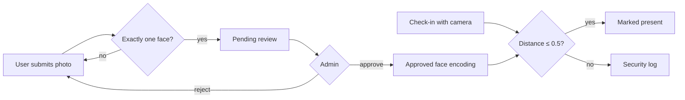

# Presence: Face Recognition Attendance

[](https://github.com/ahmedbmohamed/Presence_Management/actions/workflows/tests.yml)


A web app that takes attendance by recognising faces. Each user registers a reference photo, an admin approves it, and from then on the user checks in by looking at the camera. If the face doesn't match the approved photo, no attendance is recorded and the attempt goes to a security log.

<!-- Screenshots: add images to docs/ and reference them here, e.g.  -->

## Features

| | |
|---|---|
| **Face-verified check-in** | The live camera image is compared to the user's approved photo. Only a match records attendance. |
| **Admin approval** | Reference photos must be approved before they can be used, so nobody can register someone else's face. |
| **Security log** | Failed matches are logged with the face distance, for the admin to review. |
| **Photo quality checks** | Photos with no face or more than one face are rejected at upload. |
| **Class roster** | Students on the roster are marked absent each day until they check in. |
| **History and export** | Browse attendance by date and download it as CSV. |
| **Accounts and roles** | Admins create accounts. Passwords are stored as salted PBKDF2-SHA256 hashes. |

## How it works



Each face is turned into a 128-number encoding with [face_recognition](https://github.com/ageitgey/face_recognition) (built on dlib). A check-in matches when the distance between the live encoding and the approved one is at most `FACE_MATCH_TOLERANCE` (0.5 by default, set in [`presence/config.py`](presence/config.py)).

## Getting started

**Requirements:** Python 3.10+, and a webcam on the device you open the app from.

```bash
git clone https://github.com/ahmedbmohamed/Presence_Management.git
cd Presence_Management

python -m venv venv
venv\Scripts\activate          # Windows
# source venv/bin/activate     # macOS / Linux

pip install -r requirements.txt
pip install --no-deps face-recognition
streamlit run main.py
```

Open http://localhost:8501. On the first launch you are asked to create the admin account.

> **Why `--no-deps`?** `face-recognition` depends on `dlib`, which pip would compile from C++ source (and that fails without CMake and Visual Studio). `requirements.txt` installs `dlib-bin`, a prebuilt dlib, instead, so `face-recognition` is installed without pulling in its own dependencies. pip may then warn that `dlib` is not installed; that warning is harmless.

### First steps

1. Create the admin account, then add users under **Admin → Users**.
2. Optionally add students to the roster under **Students**.
3. Each user signs in and submits a photo under **My photo**.
4. The admin approves it under **Admin → Photo review**.
5. The user can now **Check in**.

## Project structure

```
├── main.py                 # Entry point: page config, navigation, sidebar
├── presence/
│   ├── config.py           # Paths and settings
│   ├── database.py         # SQLite connection and schema
│   ├── auth.py             # Accounts and password hashing
│   ├── face.py             # Face detection, encoding and matching
│   ├── photos.py           # Reference photo submission and review
│   ├── students.py         # Class roster
│   ├── attendance.py       # Daily attendance (CSV)
│   ├── security.py         # Security event log
│   ├── session.py          # Logged-in user
│   └── views/              # One module per page
├── tests/                  # pytest suite (runs without dlib or a camera)
└── .streamlit/config.toml  # Theme
```

Runtime data (database, photos, attendance CSV) is written to `data/`, which is git-ignored. Set `PRESENCE_DATA_DIR` to store it elsewhere.

## Running the tests

```bash
pip install -r requirements-dev.txt
pytest
```

The tests replace `face_recognition` with a lightweight fake, so they run in seconds, and they also run on GitHub Actions on every push.

## Tech stack

Python · Streamlit · face_recognition / dlib · NumPy · pandas · Pillow · SQLite · pytest

## Privacy

Face photos are personal data. Only register people who have agreed to it, and never commit the `data/` folder.

## License

[MIT](LICENSE) © Ahmed Benmohamed
